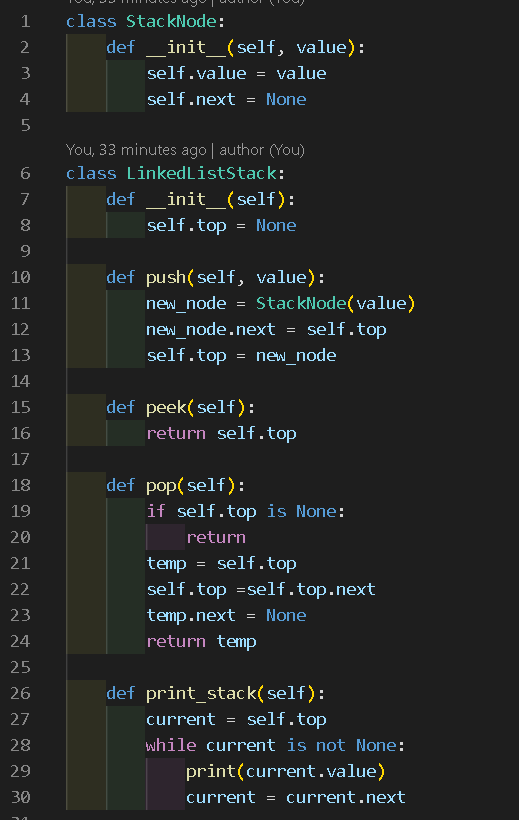

# Python Practice Files

### Current Python Files
* array_based_stack.py
* bst.py
* dict.py
* hash_table.py
* hello_world.py
* linked_list.py
* node_based.py
* paycheck_splitter.py
* Practice.py
* stack.py

